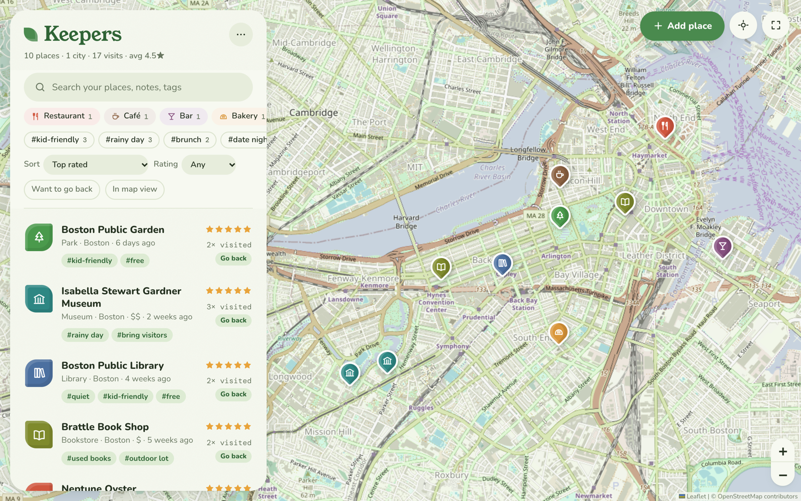

# Keepers — your favorite places, on one map

<picture>
  <source media="(prefers-color-scheme: dark)" srcset="docs/screenshot-dark.png">
  
</picture>

**Try it online:** https://antass.github.io/keepers/ (no install). The online version saves your places in that browser only, so use ⋯ → Export backup now and then.

**Run it on your Mac (saves to a file):** double-click `Keepers.command`. Your browser opens at http://localhost:8142. Keep that Terminal window open while you use it.

**On your phone:** same Wi-Fi, open the address the Terminal window prints (e.g. `http://<your-mac>.local:8142`), then Share → Add to Home Screen.

## What it does
- **Map** of every place, color-coded by type: restaurant, café, bar, bakery, museum, library, bookstore, park, shop, venue.
- **Add a place** by searching its name (OpenStreetMap; picks the type for you) or by tapping the map. Drag the pin to fine-tune.
- **Rate** 1–5 stars and set a price level ($–$$$$).
- **Tags** like `kid-friendly`, `date night`, `rainy day` — then filter by them.
- **Notes** for what to order, the best table, when it's quiet.
- **Visit log:** "Log a visit today" in one tap. Cards show how often and how recently you've been.
- **Been / Want to go:** two lists. Save places to try (hollow pins), then tap **I've been here** to rate it and move it to Been.
- **Want to go back** flag and filter.
- **Filter & sort:** search text, type, tags, minimum rating, "in map view", sort by rating / recent / most visited / nearest.
- **Apple Maps / Google Maps** links on every place.
- **Backup:** ⋯ menu → Export / Import (.json).

## Where your data lives
`data/places.json` in this folder (syncs through iCloud). Every save also keeps a timestamped copy in `data/backups/` (newest 50), plus `places.json.bak`.
